<div align="center">

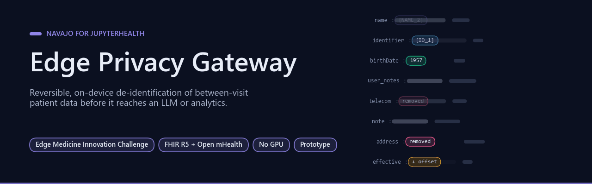

# NAVAJO Edge Privacy Gateway for JupyterHealth

[](https://github.com/Agnuxo1/edge-privacy-gateway/actions/workflows/release.yml) [](LICENSE)   [](#licence-and-data) [](https://edgemedicine.org/innovate)

[**Quick start**](#quick-start) · [**Benchmark**](#benchmark) · [**Licence and data**](#licence-and-data) · [**Pilot results**](results/quick-20261029.txt) · [**Provenance**](docs/quick-benchmark-provenance.json) · [**Experiment log**](experiments/LOG.md) · [**Protocol**](docs/RESEARCH_PROTOCOL.md) · [**Bibliography**](#bibliography)

</div>

Reversible, on-device de-identification of between-visit patient data (FHIR R5 + Open mHealth) before it reaches an LLM or analytics,
and re-identification of the answer for the clinician only. Pure Python, no GPU, no network, about 1 ms per note.
Built on the author's Project NAVAJO core (MIT, included under `vendor/`) for the [Edge Medicine Innovation Challenge](https://edgemedicine.org/innovate).

**Contents** — [Background](#background) · [Quick start](#quick-start) · [Benchmark](#benchmark) · [Real-world applications](#real-world-applications) · [Possible improvements](#possible-improvements) · [Future work](#future-work) · [Licence and data](#licence-and-data) · [Bibliography](#bibliography)

## Background

<p align="center">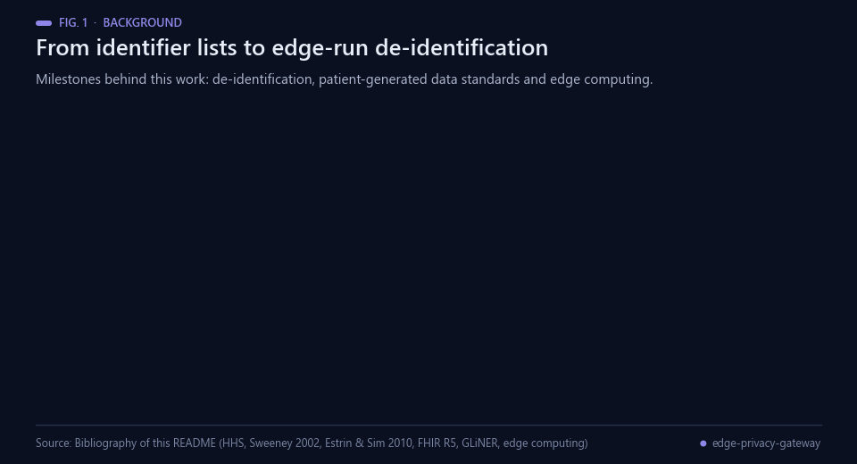<br><sub>Fig. 1 — Milestones behind this work. Sources: bibliography below.</sub></p>

Removing direct identifiers is the starting point of de-identification. The HIPAA Privacy Rule describes a "Safe
Harbor" list of identifiers to remove [[1](#ref-1)], and the *k*-anonymity model showed why that is not enough:
combinations of quasi-identifiers can still single a person out [[2](#ref-2)]. Automatic de-identification of clinical
text then developed from rules and dictionaries to statistical, machine-learned taggers [[3](#ref-3)], around shared
corpora such as the 2014 i2b2/UTHealth challenge [[4](#ref-4)]; a recent review discusses what text-anonymisation
models can and cannot guarantee [[5](#ref-5)].

The data handled here differ from discharge notes. Between visits, patients and caregivers generate readings,
symptom diaries and messages. Open mHealth proposed shared schemas for such patient-generated data [[6](#ref-6)], and
HL7 FHIR R5 [[7](#ref-7)] provides the resources (Patient, Observation, Communication) that
JupyterHealth [[8](#ref-8)] exchanges, with Open mHealth JSON carried in `Observation.valueAttachment`, as in the demo
bundle. The Edge Medicine Innovation Challenge [[9](#ref-9)] asks for health-AI work built on JupyterHealth, which is
the setting this repository was prepared for. Because free text in such records can contain names, phone numbers
and e-mail addresses, the gateway runs where the data live, on a clinic laptop or home hub, in the sense of edge
computing [[10](#ref-10)]: identifiers do not need to travel to an external model.

For comparison the benchmark uses Microsoft Presidio [[11](#ref-11)] with spaCy [[12](#ref-12)] and GLiNER [[13](#ref-13)], on
synthetic health records from NVIDIA Nemotron-PII [[14](#ref-14)] and Gretel `pii-masking-en-v1` [[15](#ref-15)]. The core
detector is the author's Project NAVAJO code (MIT), vendored in [`vendor/navajo_egp`](vendor/navajo_egp); the
author's sibling prototype EGP Clinical Shield [[16](#ref-16)] applies the same reversible-placeholder idea to Spanish
clinical notes. The clinical layer, the gateway and the benchmark in this repository are new, exploratory and
evaluated on synthetic data only.

## Quick start

<p align="center">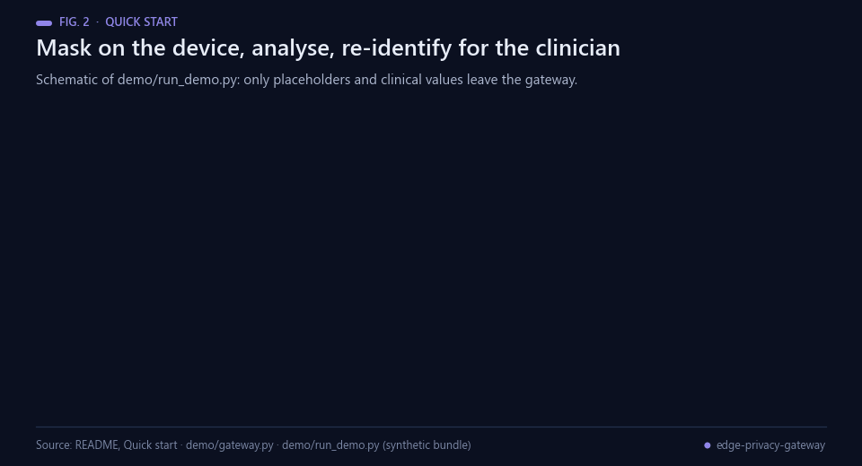<br><sub>Fig. 2 — The round trip of the demo. The session mapping lives only in memory and is destroyed afterwards.</sub></p>

```bash
pip install pytest
python demo/run_demo.py           # synthetic JupyterHealth bundle -> safe bundle -> clinician view
python -m pytest -q demo           # round-trip and no-hard-identifier test
```

<p align="center">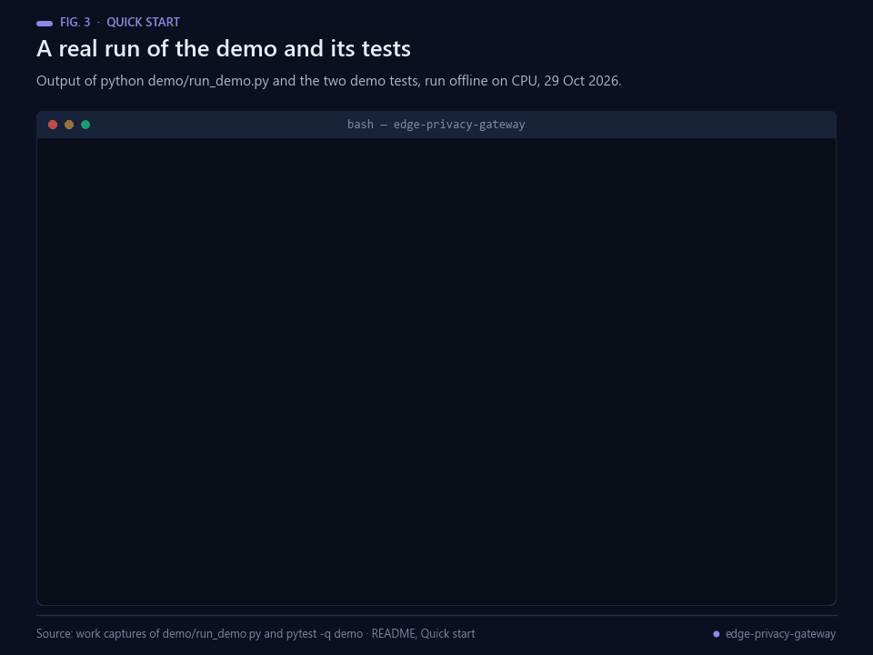<br><sub>Fig. 3 — A real local run of the demo and of <code>pytest -q demo</code> (2 passed), offline on CPU.</sub></p>

What the demo does (`demo/gateway.py`):

| Data | Treatment |
|---|---|
| Patient name, identifier | stable pseudonym (`[NAME_2]`, `[ID_1]`) kept in an ephemeral session |
| telecom, address, photo, contact | removed |
| birthDate | year only (partial generalisation; not a compliance guarantee) |
| Free text (`user_notes`, notes, messages) | NAVAJO-v2 detector, reversible placeholders (`[PHI_3]`) |
| Dates and times | shifted by a random per-session offset; intervals preserved |
| Clinical values (mmHg, mg/dL, doses) | untouched |
| Open mHealth payload in `Observation.valueAttachment` (base64 JSON) | decoded, processed, re-encoded |

<p align="center">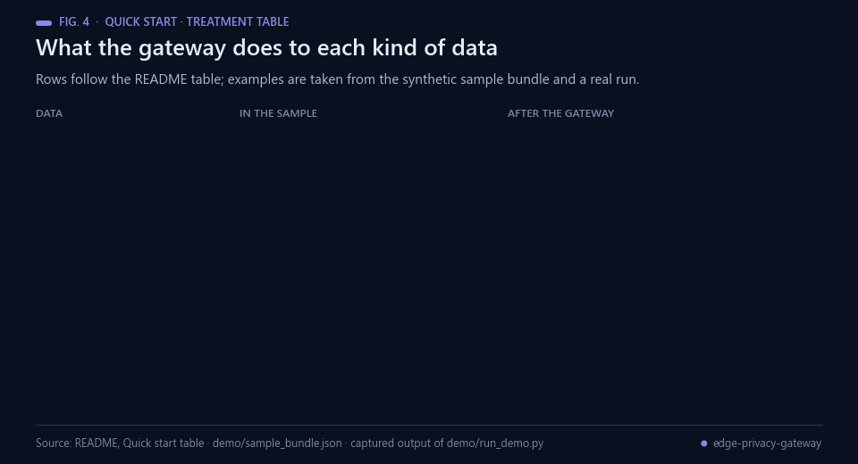<br><sub>Fig. 4 — The treatment table with values from the synthetic sample bundle and one captured run.</sub></p>

<p align="center">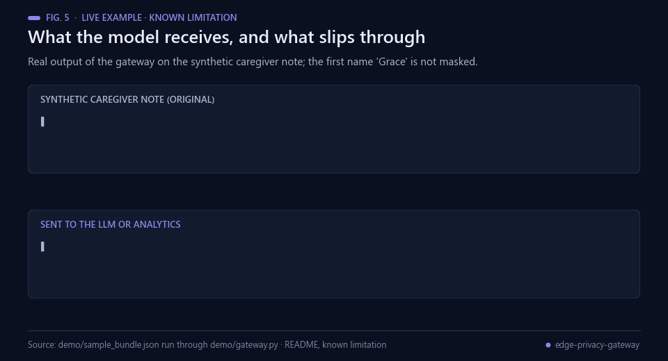<br><sub>Fig. 5 — Real output of the gateway on the synthetic note; 'Grace' is the limitation stated above.</sub></p>

Known limitation shown by the demo itself: a first name that is neither in the lexicon nor after a field label or title
(“daughter Grace”) passes through. The benchmark below quantifies this (novel-name recall) A hybrid GLiNER comparison is running; no completed hybrid improvement is claimed yet.

## Benchmark

<p align="center">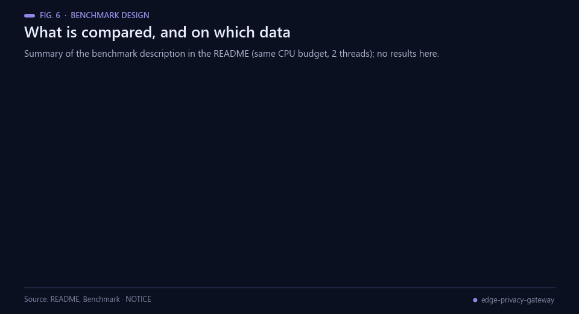<br><sub>Fig. 6 — The benchmark design as described in this section (no results).</sub></p>

`bench/` compares, on the same CPU budget (2 threads):

- `navajo_v1`: NAVAJO as published (regex), `navajo_v2`: clinical layer added here, plus six ablations;
- Microsoft Presidio (spaCy `en_core_web_lg`), GLiNER (`gretelai/gretel-gliner-bi-small-v1.0`, fp32 and dynamic int8);
- `nvidia/gliner-PII` only as a reference: it was trained on Nemotron-PII, so its Nemotron numbers are contaminated.

Data: NVIDIA Nemotron-PII (CC BY 4.0) health domains, planned full test (7,058 synthetic documents), three disjoint
partitions (mean ± sd); Gretel `pii-masking-en-v1` (Apache-2.0) health domains (403 documents) as an out-of-distribution check.
NAVAJO-v2 rules and its name lexicon were developed only on the Nemotron train split. Thresholds of Presidio and GLiNER were
picked on 300 train documents. Metrics: character recall of HIPAA Safe Harbor identifiers, precision, F2, full-entity recall,
secrets, share of clinical measurements left intact, recall on names unseen in train, latency p50/p95, peak RSS.

The offline synthetic demo and its tests run with the bundled frozen training lexicon, without the benchmark datasets. Missing lexicons now fail closed instead of silently weakening masking. The full benchmark script `bash bench/job.sh` requires the external `data/sub/{nem_train_health,nem_test_health,gretel_test_health}.jsonl` files, their annotated schema and the bundled frozen train lexicon. It creates a Linux environment, downloads comparison models and writes `results/`. The dataset extraction is not yet packaged here; full end-to-end benchmark reproduction remains incomplete. Do not mistake the demo for a reproduction of the reported benchmark.

<p align="center">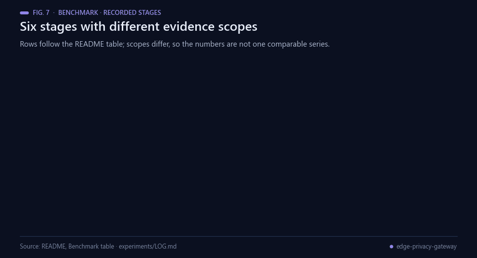<br><sub>Fig. 7 — The stage table. Scopes differ, so the rows are not one comparable series. Data: the table below.</sub></p>

| Stage | Recorded result | Evidence scope |
|---|---|---|
| E001, NAVAJO v1 | F2 0.603, precision 0.374; one detector crash |1500 train documents |
| E002, clinical layer | F2 0.930 | held-out train partition |
| E003, frozen v2 | F2 **0.943**, precision 0.926, clinical values retained0.974; no-lexicon F2 0.894 | Development partition; selection evidence |
| E004, plumbing smoke | v2 F2 **0.909** vs v1 **0.550** |300 test documents; exploratory exposure, not untouched final test |
| E005 | Completed: 200 documents per dataset, all methods and ablations retained below | Exploratory quick comparison, not full-test confirmation |
| E006 | Full benchmark running, job 4ed488c393f24a72 | No complete full-test result yet |

Full results must replace this status only after the actual outputs are checked. Test has already been inspected on 300 documents, so a later full test is not described as wholly unseen. These are public **synthetic** health records, not real patient validation. No clinical deployment, safety or regulatory compliance is established.

### Completed server pilot, 29 October

<p align="center">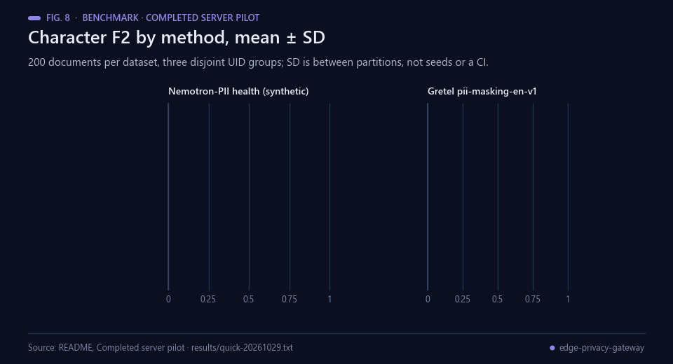<br><sub>Fig. 8 — Pilot F2, mean ± SD between three data partitions (not seeds, not a confidence interval). Data: results/quick-20261029.txt.</sub></p>

| Method | Nemotron F2, mean ± SD | Gretel F2, mean ± SD | Nemotron median ms |
|---|---:|---:|---:|
| NAVAJO v1 |0.562±0.030 |0.665±0.023 |0.3 |
| **NAVAJO v2** |**0.910±0.011** |**0.879±0.025** |0.7 |
| Presidio |0.825±0.023 |0.809±0.027 |22.1 |
| GLiNER Gretel |0.764±0.031 |0.949±0.024 |665.8 |
| **v2 + GLiNER Gretel** |**0.933±0.012** |**0.960±0.016** |666.6 |
| GLiNER Gretel int8 |0.262±0.009 |0.624±0.033 |382.6 |

<p align="center">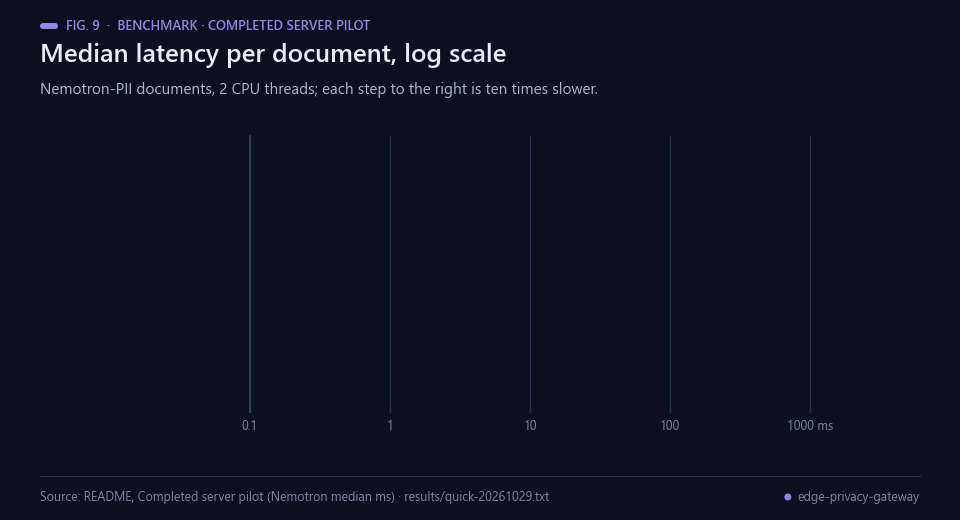<br><sub>Fig. 9 — Median latency per document on a log axis. Data: the Nemotron median column of the table above.</sub></p>

These are 200 documents per dataset, partitioned into three disjoint UID groups.
SD is between these data partitions, not independent training seeds or a 95% confidence interval.
The measured v2-versus-v1 improvement is positive on both datasets. The hybrid improves F2
but has a large latency/memory cost. Int8 markedly degrades the standalone detector in this
pilot. [Every method, ablation, metric, latency and crash count](results/quick-20261029.txt)
is retained, including the contaminated NVIDIA reference. Its Nemotron results cannot be
used as independent held-out evidence. No system is reselected or retuned from this pilot;
full evaluation and independent clinical validation remain separate obligations.

<p align="center">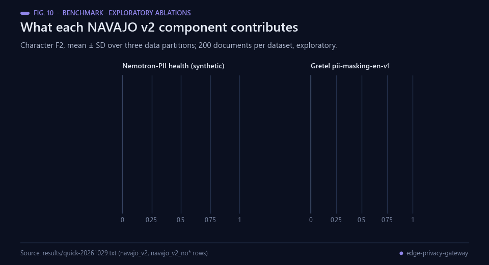<br><sub>Fig. 10 — Exploratory ablations of NAVAJO v2 from the completed pilot. Data: results/quick-20261029.txt.</sub></p>

## Real-world applications

<p align="center">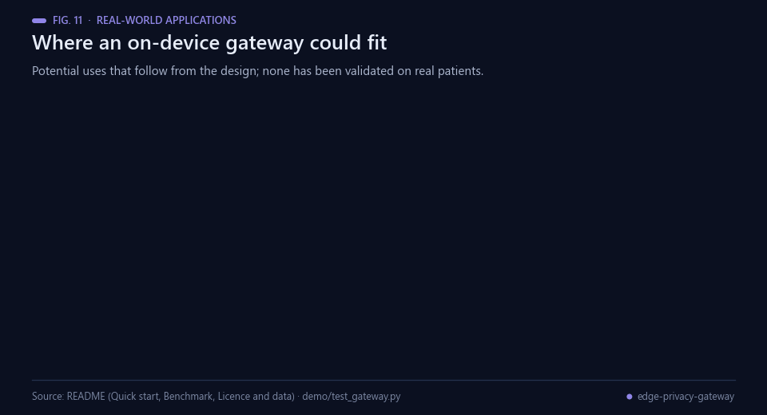<br><sub>Fig. 11 — Where an on-device gateway could fit. None of these uses has been validated on real patients.</sub></p>

Home monitoring and remote follow-up produce readings, symptom diaries and messages between visits
[[6](#ref-6), [8](#ref-8)]. Potential uses that follow from the design described in this repository:

- **Summaries of between-visit data.** Blood-pressure and glucose readings with caregiver notes could be masked
  on the device before a language model drafts a summary.
- **Clinician-only re-identification.** The mapping from placeholders to real values stays in an ephemeral
  session, so only the clinician's view restores names.
- **Analytics on de-identified bundles.** FHIR bundles with pseudonymised identifiers, shifted dates and intact
  clinical values could feed analytics notebooks with far fewer direct identifiers [[7](#ref-7)]; residual risk
  remains (novel names can pass through, as the Quick start shows).
- **Edge deployment.** Pure Python with no GPU and no network, about 1 ms per note as stated above, could suit a
  clinic laptop or home hub [[10](#ref-10)].
- **Fail-closed packaging.** A missing frozen lexicon stops the gateway instead of silently weakening masking; a
  demo test covers this.
- **Detector evaluation.** The benchmark scripts compare rule-based and model-based detectors on synthetic health
  records before any real-data study.

This repository states that no clinical deployment, safety or regulatory compliance is established; any real use would
need its own data-protection assessment and clinical validation.

## Possible improvements

<p align="center">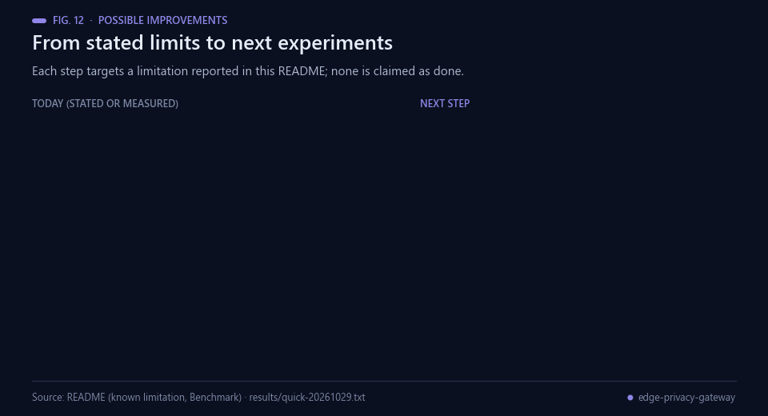<br><sub>Fig. 12 — Each improvement targets a limitation stated or measured in this repository.</sub></p>

- **Novel first names.** The demo passes "daughter Grace" through. NAVAJO v2 recalls 0.568 (Nemotron) and 0.662
  (Gretel) of names unseen in train in the pilot. A learned name detector such as GLiNER [[13](#ref-13)] is the obvious
  candidate; it must be re-measured on held-out partitions.
- **Reproducibility.** The demo is not a reproduction of the benchmark and the dataset extraction is not packaged.
  Packaging the extraction scripts would let `bash bench/job.sh` run end to end.
- **Cost of the hybrid.** The v2 + GLiNER Gretel hybrid reaches Nemotron F2 0.933 at 666.6 ms median latency and
  2308 MB peak RSS, against 0.910, 0.7 ms and 20 MB for NAVAJO v2 alone; the int8 variant alone reaches only 0.262.
  Cheaper second-stage detectors are worth testing.
- **Quasi-identifiers.** Birth year, dates shifted by one random offset and rare combinations of free-text facts
  can still be identifying [[2](#ref-2)]; risk flags before sending would make this visible.
- **Real-world validation.** All records are public synthetic data. Consented real data and clinical review are
  needed before any claim of safety.

## Future work

<p align="center">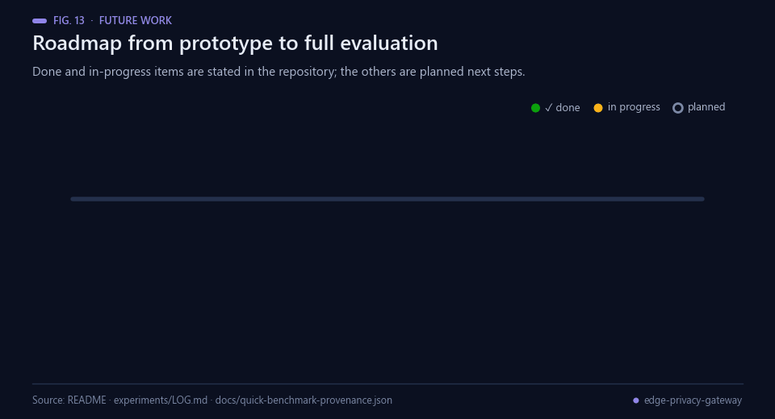<br><sub>Fig. 13 — Done and in-progress items are stated in this repository; the rest are planned.</sub></p>

Next steps, in order. Items 1 and 2 are stated in the README as running; the others are planned and not started:

1. Finish the full benchmark (E006) and replace the status table only after the actual outputs are checked.
2. Complete the GLiNER hybrid comparison; no hybrid improvement is claimed until then.
3. Package the dataset extraction so the benchmark can be reproduced end to end.
4. Improve recall of novel names and re-measure it on held-out partitions.
5. Validate on consented real-world data with clinical oversight, with a data-protection assessment.

## Licence and data

MIT (original code and NAVAJO core). Datasets are not redistributed in this repository. Obtain the derived health subsets externally under their original
licences (CC BY 4.0, NVIDIA Nemotron-PII; Apache-2.0, Gretel). All records are synthetic; no real patient data is used.

## Bibliography

1. <a id="ref-1"></a>U.S. Department of Health and Human Services, Office for Civil Rights (2012). *Guidance regarding methods for de-identification of protected health information in accordance with the HIPAA Privacy Rule* (page last reviewed 3 February 2025). https://www.hhs.gov/hipaa/for-professionals/special-topics/de-identification/index.html
2. <a id="ref-2"></a>Sweeney, L. (2002). k-anonymity: A model for protecting privacy. *International Journal of Uncertainty, Fuzziness and Knowledge-Based Systems*, 10(5), 557–570. https://doi.org/10.1142/S0218488502001648
3. <a id="ref-3"></a>Meystre, S. M., Friedlin, F. J., South, B. R., Shen, S., & Samore, M. H. (2010). Automatic de-identification of textual documents in the electronic health record: a review of recent research. *BMC Medical Research Methodology*, 10, 70. https://doi.org/10.1186/1471-2288-10-70
4. <a id="ref-4"></a>Stubbs, A., & Uzuner, Ö. (2015). Annotating longitudinal clinical narratives for de-identification: The 2014 i2b2/UTHealth corpus. *Journal of Biomedical Informatics*, 58, S20–S29. https://doi.org/10.1016/j.jbi.2015.07.020
5. <a id="ref-5"></a>Lison, P., Pilán, I., Sanchez, D., Batet, M., & Øvrelid, L. (2021). Anonymisation Models for Text Data: State of the art, Challenges and Future Directions. *Proceedings of the 59th Annual Meeting of the Association for Computational Linguistics and the 11th International Joint Conference on Natural Language Processing (Volume 1: Long Papers)*, 4188–4203. https://doi.org/10.18653/v1/2021.acl-long.323
6. <a id="ref-6"></a>Estrin, D., & Sim, I. (2010). Open mHealth Architecture: An Engine for Health Care Innovation. *Science*, 330(6005), 759–760. https://doi.org/10.1126/science.1196187
7. <a id="ref-7"></a>HL7 International (2023). *FHIR Release 5 (v5.0.0)*. https://hl7.org/fhir/R5/
8. <a id="ref-8"></a>JupyterHealth. *Open infrastructure for health care* (project website). https://jupyterhealth.org
9. <a id="ref-9"></a>Edge Medicine. *Edge Medicine Innovation Challenge* (competition page). https://edgemedicine.org/innovate
10. <a id="ref-10"></a>Shi, W., Cao, J., Zhang, Q., Li, Y., & Xu, L. (2016). Edge Computing: Vision and Challenges. *IEEE Internet of Things Journal*, 3(5), 637–646. https://doi.org/10.1109/JIOT.2016.2579198
11. <a id="ref-11"></a>Microsoft. *Presidio: data protection and de-identification SDK* (software). https://github.com/microsoft/presidio
12. <a id="ref-12"></a>Honnibal, M., Montani, I., Van Landeghem, S., & Boyd, A. (2020). *spaCy: Industrial-strength natural language processing in Python*. Zenodo. https://doi.org/10.5281/zenodo.1212303
13. <a id="ref-13"></a>Zaratiana, U., Tomeh, N., Holat, P., & Charnois, T. (2024). GLiNER: Generalist Model for Named Entity Recognition using Bidirectional Transformer. *Proceedings of the 2024 Conference of the North American Chapter of the Association for Computational Linguistics: Human Language Technologies (Volume 1: Long Papers)*, 5364–5376. https://doi.org/10.18653/v1/2024.naacl-long.300
14. <a id="ref-14"></a>NVIDIA. *Nemotron-PII* (synthetic personally identifiable information dataset; CC BY 4.0). Hugging Face. https://huggingface.co/datasets/nvidia/Nemotron-PII
15. <a id="ref-15"></a>Gretel AI. *gretel-pii-masking-en-v1* (synthetic PII masking dataset; Apache-2.0). Hugging Face. https://huggingface.co/datasets/gretelai/gretel-pii-masking-en-v1
16. <a id="ref-16"></a>Angulo de Lafuente, F. *EGP Clinical Shield: on-device pseudonymisation of clinical notes before AI assistants* (software, prototype). https://github.com/Agnuxo1/egp-clinical-shield

---

<div align="center">
<sub>Built by <a href="https://github.com/Agnuxo1">Francisco Angulo de Lafuente</a> · every figure is an animated
rendering of the published file named in its footer · <a href="#navajo-edge-privacy-gateway-for-jupyterhealth">back to top ↑</a></sub>
</div>
